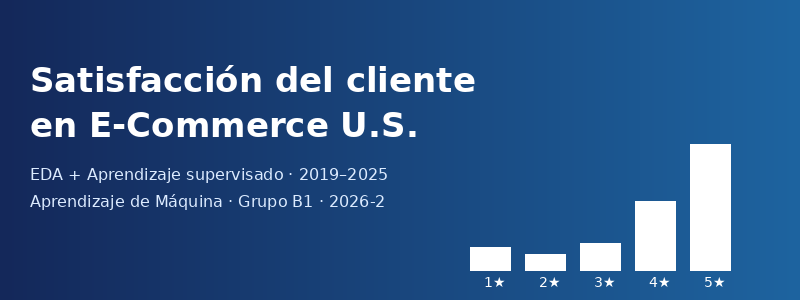

<p align="center">
  
</p>

# Predicción de la satisfacción del cliente en E-Commerce U.S. (2019–2025)

**Autores:** Jose Javier Acevedo Ruis, Joshua Alejandro Saavedra Cardenas

**Objetivo:** Identificar los factores que explican la reseña (`review_score`) de un pedido y predecir si el cliente quedará insatisfecho (score ≤ 3).

**Dataset:** *E-Commerce U.S Dataset (2019~2025, 1 Million rows)* — base sintética de 1.000.000 de pedidos en 8 tablas relacionales (clientes, pedidos, ítems, productos, vendedores, pagos, reseñas, geolocalización). [Descargar en Kaggle](https://www.kaggle.com/datasets/limjeongeun/synthetic-u-s-e-commerce-dataset-1m-orders) — en el notebook se descarga automáticamente con `kagglehub`.

**Modelos:** `GaussianNB`, `DecisionTree`, `RandomForest`, `SVM`, `LinearRegression`, `Ridge`, `HistGradientBoosting`, `SHAP`

**Enlaces:**
- 💻 Código (notebook): [`notebooks/EDA_ML_Ecommerce_US_B1.ipynb`](notebooks/EDA_ML_Ecommerce_US_B1.ipynb) · [Abrir en Colab](https://colab.research.google.com/github/nothave28-oss/ml-satisfaccion-ecommerce-us/blob/main/notebooks/EDA_ML_Ecommerce_US_B1.ipynb)
- 🎥 Video: **PEGAR_LINK_DEL_VIDEO**
- 📦 Repositorio: https://github.com/nothave28-oss/ml-satisfaccion-ecommerce-us
- 🎨 Presentación (Canva): https://canva.link/wnvmyavlbp4ymal

---

## Estructura del repositorio

```
├── README.md
├── requirements.txt
├── .gitignore
├── assets/
│   └── banner.png
└── notebooks/
    └── EDA_ML_Ecommerce_US_B1.ipynb
```

## Cómo ejecutarlo

1. Abre el notebook en Google Colab (enlace de arriba).
2. Ejecuta todas las celdas en orden (`Entorno de ejecución > Ejecutar todo`). El dataset se descarga solo con `kagglehub`.

En local:

```bash
pip install -r requirements.txt
jupyter notebook notebooks/EDA_ML_Ecommerce_US_B1.ipynb
```
